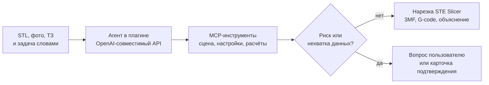

<p align="center">
  <picture>
    <source media="(prefers-color-scheme: dark)" srcset="docs/readme/banner.dark.png">
    
  </picture>
</p>

<p align="center">
  Оператор 3D-принтеров загружает модель, фото и пишет задачу словами, а получает настройки печати с
  объяснением каждой и готовый G-код, без ручной возни со слайсером.
</p>

<p align="center">
  <!-- readme:buttons -->
  <a href="#запуск"><picture><source media="(prefers-color-scheme: dark)" srcset="docs/readme/cta-run.dark.png"></picture></a>
  <a href="docs/README.md"><picture><source media="(prefers-color-scheme: dark)" srcset="docs/readme/cta-docs.dark.png"></picture></a>
  <!-- /readme:buttons -->
</p>

<p align="center">
  <!-- readme:status -->
  <picture><source media="(prefers-color-scheme: dark)" srcset="docs/readme/badge-status-4.dark.png"></picture>
  <a href="LICENSE"><picture><source media="(prefers-color-scheme: dark)" srcset="docs/readme/badge-status-5.dark.png"></picture></a>
  <!-- /readme:status -->
</p>


<p align="center">
  <!-- readme:nav -->
  <a href="#зачем-это"><picture><source media="(prefers-color-scheme: dark)" srcset="docs/readme/badge-nav-1.dark.png"></picture></a>
  <a href="#как-это-работает"><picture><source media="(prefers-color-scheme: dark)" srcset="docs/readme/badge-nav-2.dark.png"></picture></a>
  <a href="#попробовать-за-две-минуты"><picture><source media="(prefers-color-scheme: dark)" srcset="docs/readme/badge-nav-3.dark.png"></picture></a>
  <br>
  <a href="#результаты"><picture><source media="(prefers-color-scheme: dark)" srcset="docs/readme/badge-nav-4.dark.png"></picture></a>
  <a href="#запуск"><picture><source media="(prefers-color-scheme: dark)" srcset="docs/readme/badge-nav-5.dark.png"></picture></a>
  <a href="#устройство"><picture><source media="(prefers-color-scheme: dark)" srcset="docs/readme/badge-nav-6.dark.png"></picture></a>
  <a href="#ограничения"><picture><source media="(prefers-color-scheme: dark)" srcset="docs/readme/badge-nav-7.dark.png"></picture></a>
  <!-- /readme:nav -->

<p align="center">
  
  <br>
  <sub>Прогон 2026-10-24 на стенде STE Slicer 7.10.12: шестерня из набора организаторов, расчёт до печати.</sub>
</p>

> **Brim меняет только то, что можно объяснить строкой ТЗ, и показывает каждое действие.** Каждый вызов
> инструмента виден в чате с аргументами; крупные изменения ждут подтверждения пользователя.

## Зачем это

В STE Slicer 661 параметр. Начинающий технолог знает свою деталь — нагрузку, температуру, среду, — но
не знает, какие из этих параметров ей важны, и не умеет выбирать между 3D и двумя 5D-режимами
Stereotech. Ошибку он видит только после печати.

Brim — чат внутри слайсера. Пользователь прикладывает STL, фото и ТЗ детали и пишет задачу словами.
Агент читает ТЗ, подбирает материал, проверяет прочность расчётом, выбирает режим и ориентацию,
нарезает модель и объясняет каждое решение. На выходе — проект 3MF, G-code и переписка как отчёт.

Название — кайма (brim) вокруг детали на первом слое: она удерживает деталь, пока идёт печать.
Аудитория и аналоги — в [аналитике](docs/analytics.md).

## Как это работает



**Четыре скилла.** «Новичок» объясняет каждый параметр, «Инженер» переводит ТЗ в таблицу требований с
цитатами, «Материал» подбирает пластик из 16 семейств, «Дефекты» разбирает фото напечатанной детали.
Агент выбирает скилл сам, пользователь может закрепить нужный.

**Расчёты до печати.** Изгиб зуба по Льюису, кручение вала, напряжения во вращающемся диске, масса,
тепловое расширение, компенсация отверстий — формула видна в чате.

**Агент внутри плагина.** OpenAI-совместимый клиент, MCP-хост и MCP-сервер на Python 3.5 в процессе
слайсера. Нужны только URL, ключ и модель; сервер и база не нужны.

## Попробовать за две минуты

После [установки](#запуск):

| # | Действие | Что видно |
|---|---|---|
| 1 | «Brim» → «Открыть чат», приложить STL и ТЗ, написать задачу | Агент читает ТЗ и строит таблицу требований |
| 2 | Дождаться выбора материала и режима | Каждый вызов инструмента — строка с аргументами |
| 3 | Ответить на вопрос агента или подтвердить крупное изменение | Без ответа проект не меняется |
| 4 | Дождаться нарезки | Время печати, расход, кнопки G-code и 3MF |

## Результаты

Семь моделей организаторов прогнаны через чат 2026-10-24 на стенде (Windows 10, STE Slicer 7.10.12,
профиль Stereotech Hybrid 530 V5.2.4). Подробности и найденные ошибки — в
[аналитике](docs/analytics.md).

| Модель | Режим | Материал | Время печати, масса |
|---|---|---|---|
| Шестерня | classic | Fiberpart PC G20 | 1 ч 30 мин, 4,9 г |
| Колесо конвейера | cylindrical | Enduse TPU D70 | 14,3 ч, 58,3 г |
| Пыльник ШРУСа | classic | Sealant TPU A95 | 33,6 ч, 83,2 г |
| Фигурка | classic | Fiberpart ABSPA G8 | 74,0 ч, 192,8 г |
| Колесо насоса Wilo | cylindrical | Fiberpart PP G30 | 41,6 ч, 190 г |
| Крыльчатка | classic | Fiberpart PA12 G12 | 12,7 ч, 69 г |
| Ось Krones | cylindrical_full | Enduse PA6 | 6,1 ч, 16,2 г |

У шести моделей режим указан в имени папки; агент выбрал тот же у всех шести. G-code проверен
вручную: режим в заголовке совпадает с 3MF, температура сопла — с материалом, у 5D есть оси A/C.
Ничего не печаталось; близость к эталонным 3MF жюри неизвестна.

## Запуск

```bash
python3 plugin/build.py
```

Архив `plugin/dist/Brim-<версия>.zip` распакуйте в `%APPDATA%\steslicer\7.x\plugins` и перезапустите
STE Slicer. В «Brim» → «Настройки» укажите URL OpenAI-совместимого API, модель и ключ. Агент работает
внутри плагина, базы данных нет.

Для Claude по подписке поднимите прокси и укажите в плагине URL `http://<адрес>:8000/v1`, модель
`sonnet` и OAuth-токен из `claude setup-token`:

```bash
cp .env.example .env
LLM=true docker buildx bake
docker compose up
```

<details>
<summary><b>Разработка, проверки, переменные</b></summary>
<br>

```bash
cd backend && uv sync && uv run uvicorn app.main:create_app --factory --reload
```

Проверки бэкенда: `cd backend && uv run ruff check . && uv run mypy . && uv run pytest tests/unit`.
Проверки плагина: `cd plugin && PYTHONPATH=. python3 -B -m unittest discover -s tests -t .`.
Переменные окружения и тесты — в [запуске и проверках](docs/running.md).

</details>

## Устройство

Плагин — это и интерфейс, и агент: решения о печати принимает модель, плагин исполняет их через
MCP-инструменты в главном потоке Qt.

| Документ | Что внутри |
|---|---|
| [Архитектура](docs/architecture.md) | Части плагина и путь запроса |
| [API](docs/api.md) | MCP-инструменты и прокси-эндпоинт |
| [Зависимости](docs/dependencies.md) | Компоненты и библиотеки с версиями и лицензиями |
| [Аналитика](docs/analytics.md) | Аудитория, аналоги, ценность |
| [Оглавление](docs/README.md) | Все страницы |

## Ограничения

- **Прогоны шли через Claude по подписке.** LLM организаторов (`qwen3.8-flash`) проверена только
  одиночными запросами с картинкой и tools; время и качество на ней могут отличаться.
- **Сравнение с ручной настройкой не замерено.** Скорость «в N раз» не заявляется.
- **Разбор дефектов по фото не проверен на реальных фото брака.**
- **Один прогон модели занимает 9–40 минут**, большая часть — ходы модели и нарезка.

## Для команды

Этот блок вырезается при сдаче вместе с маркерами `scrub:start` и `scrub:end`.

1. `bash .claude/scripts/setup.sh` — один раз на клон: хуки коммитов и ссылки на общий каталог `skills/` для Claude Code и Codex.
   Все скилы лежат в `skills/`; `.claude/skills/<имя>` и `.agents/skills/<имя>` ссылаются на одни
   и те же исходники. После добавления или удаления скила — `bash .claude/scripts/sync-agents.sh`.
2. Материалы организаторов — в `brief/sources/`, затем скил `hack-kickoff`: `brief/` и `context/`, шапка
   `AGENTS.md`, тезис и P0-сценарий.
3. Название и знак — скилы `naming` и `brand-identity`.
4. Картинки README в `docs/readme/` — готовые PNG; генератор удалён вместе с движком презентаций.
   Текст слайдов защиты — `presentation/slides/slides.md`.
5. Этот README ведёт скил `readme`: рабочая версия во время хакатона, продуктовая к сдаче.
   Документация — `docs-writing`, сдача — `submission`.

Международный хакатон: README, `docs/`, ассеты и слайды по-английски, заголовки и якоря переводятся
вместе.

Перед защитой: `bash .claude/scripts/strip-ai.sh` показывает на копии, что будет удалено, какие
следы останутся и что не так в истории коммитов. `--apply` удаляет файлы агентов и внутренние
доки (список в `.claude/scrub-paths`), `--apply --history` ещё и переписывает всю историю: только
заголовки, без соавторов и агентов. Перед изменениями скрипт сохраняет бэкап.
<!-- scrub:end -->

<p align="center">
  <picture><source media="(prefers-color-scheme: dark)" srcset="docs/readme/mark.dark.png"></picture>
  <br>
  <sub>Команда Brim, хакатон «Открой Моспром», 2026.</sub>
</p>
