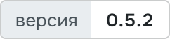
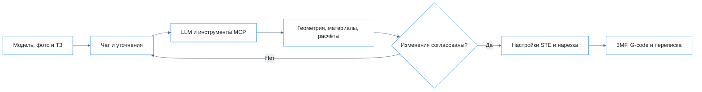

<p align="center">
  <picture>
    <source media="(prefers-color-scheme: dark)" srcset="docs/readme/banner.dark-9267dbed.png">
    
  </picture>
</p>

Пользователь прикладывает модель, техническое задание и фото. Brim уточняет задачу, выбирает
материал и настройки, применяет их в STE Slicer и сохраняет проект 3MF и G-code.

<p align="center">
  <!-- readme:buttons -->
  <a href="#запуск"><picture><source media="(prefers-color-scheme: dark)" srcset="docs/readme/cta-run.dark-52a53f06.png"></picture></a>
  <a href="docs/user-guide.md"><picture><source media="(prefers-color-scheme: dark)" srcset="docs/readme/cta-guide.dark-a16cec3b.png"></picture></a>
  <a href="docs/README.md"><picture><source media="(prefers-color-scheme: dark)" srcset="docs/readme/cta-docs.dark-c0fb90db.png"></picture></a>
  <!-- /readme:buttons -->
</p>
<p align="center">
  <!-- readme:status -->
  <a href="#результаты"><picture><source media="(prefers-color-scheme: dark)" srcset="docs/readme/badge-status-1.dark-92b5242e.png"></picture></a>
  <a href="plugin/Brim/plugin.json"><picture><source media="(prefers-color-scheme: dark)" srcset="docs/readme/badge-status-2.dark-3807d0e9.png"></picture></a>
  <br>
  <picture><source media="(prefers-color-scheme: dark)" srcset="docs/readme/badge-status-3.dark-9467c025.png"></picture>
  <a href="LICENSE"><picture><source media="(prefers-color-scheme: dark)" srcset="docs/readme/badge-status-4.dark-1ef054d7.png"></picture></a>
  <!-- /readme:status -->
</p>
<p align="center">
  <!-- readme:stack -->
  <picture><source media="(prefers-color-scheme: dark)" srcset="docs/readme/badge-stack-1.dark-bd12d1cd.png"></picture>
  <picture><source media="(prefers-color-scheme: dark)" srcset="docs/readme/badge-stack-2.dark-5d03e190.png"></picture>
  <br>
  <picture><source media="(prefers-color-scheme: dark)" srcset="docs/readme/badge-stack-3.dark-4f8ee4a0.png"></picture>
  <picture><source media="(prefers-color-scheme: dark)" srcset="docs/readme/badge-stack-4.dark-5457ede0.png"></picture>
  <!-- /readme:stack -->
</p>
<p align="center">
  <!-- readme:nav -->
  <a href="#зачем-это"><picture><source media="(prefers-color-scheme: dark)" srcset="docs/readme/badge-nav-1.dark-d7e5fdce.png"></picture></a>
  <a href="#как-это-работает"><picture><source media="(prefers-color-scheme: dark)" srcset="docs/readme/badge-nav-2.dark-2609810d.png"></picture></a>
  <a href="#попробовать"><picture><source media="(prefers-color-scheme: dark)" srcset="docs/readme/badge-nav-3.dark-e3e568de.png"></picture></a>
  <br>
  <a href="#результаты"><picture><source media="(prefers-color-scheme: dark)" srcset="docs/readme/badge-nav-4.dark-76832f05.png"></picture></a>
  <a href="#запуск"><picture><source media="(prefers-color-scheme: dark)" srcset="docs/readme/badge-nav-5.dark-4525057b.png"></picture></a>
  <a href="#устройство"><picture><source media="(prefers-color-scheme: dark)" srcset="docs/readme/badge-nav-6.dark-d24e85e5.png"></picture></a>
  <a href="#ограничения"><picture><source media="(prefers-color-scheme: dark)" srcset="docs/readme/badge-nav-7.dark-641a83f8.png"></picture></a>
  <!-- /readme:nav -->
</p>


> **Отклонённое изменение не применяется.** Brim возвращает отказ и комментарий агенту,
> чтобы тот мог пересмотреть предложение. Это поведение проверяется тестами подтверждений.

## Зачем это

Настройки материала, ориентации, поддержек и режима печати нужно связать с требованиями конкретной
детали. Brim читает ТЗ и состояние настоящего слайсера, задаёт вопросы о недостающих данных
и выполняет изменения через инструменты. Пользователь видит действия и может отклонить их
с комментарием.

На стенде через Brim получены комплекты файлов для семи моделей организаторов. Для шестерни
расчёт показал недостаточный запас под заданный момент; риск остался в диалоге и отчёте.
Полученный G-code сам по себе не доказывает выполнение физических требований к детали.

Brim — кайма вокруг детали на первом слое. Знак продукта повторяет её кольца.
Аудитория, аналоги и исходные данные — в [аналитике](docs/analytics.md).

## Как это работает



- **Сцена доступна агенту:** объекты, габариты, материалы, профиль и текущие значения настроек.
  Импорт, поворот, выбор режима и нарезка выполняются в STE.
- **Есть четыре специализации:** «Новичок», «Инженер», «Материал», «Дефекты». Агент выбирает
  подходящую либо использует закреплённую пользователем. DOCX, таблицы и текстовые PDF читает
  отдельными инструментами; инженерные оценки возвращают формулы и допущения.
- **Результат сохраняется вместе с работой:** отдельный проект на чат, история инструментов,
  G-code и 3MF. Из панели экспортируется также переписка с PNG-снимками.

Чат работает в панели слайсера и в браузере через локальный HTTP-сервер. В обеих оболочках
доступны RU/EN и светлая/тёмная темы. В «С подтверждением» изменения принимаются карточками;
в «Авто» остаётся проверка резких числовых изменений. Остановка не откатывает выполненные операции.

## Попробовать

После установки и настройки LLM:

| Шаг | Действие | Что увидеть |
|---|---|---|
| 1 | «Brim → Открыть чат», новый чат | Новую историю и пустую сцену |
| 2 | Прикрепить STL и ТЗ; написать «Прочитай ТЗ, проверь геометрию и предложи настройки» | Чтение документа, действия агента и вопросы |
| 3 | Ответить на вопросы, принять изменения и нарезку | Настроенную сцену и карточку результата с файлами |

[Руководство пользователя](docs/user-guide.md) объясняет чаты, калибровку и экспорт.
Браузерный чат требует запущенного STE и доступной LLM.

## Результаты

24.10.2026, Windows 10, STE Slicer 7.10.12, Claude через backend:

| Проверка | Результат | Граница |
|---|---|---|
| Семь официальных моделей | Получены 3MF, G-code и экспорт чата для всех семи | Были ошибки и повторные попытки; комплект хранится на стенде |
| 3D/5D | Использованы classic, cylindrical, cylindrical_full | Не доказана устойчивость любой последовательности режимов |
| Браузерный чат | Один полный прогон 0.5.2 в Edge до скачивания G-code | Не вся матрица инструментов |
| Калибровочная фигурка | Сгенерирована и нарезана; Fine 0,1 мм: 3 ч 12 мин, 13,9 г | Не напечатана, цикл по реальным фото не проверен |
| Локальные проверки кода | Плагин: 153 прошли, 2 пропущены; backend: 67 прошли, Ruff и mypy без ошибок | Тестовые провайдеры и слайсер; не физическая печать |

[Протокол и условия](docs/evidence.md) отделяют оценки слайсера от измерений.
Сравнения скорости с ручной настройкой нет; эталонные 3MF организаторы участникам не выдавали.

## Запуск

Из корня репозитория:

```bash
python3 plugin/build.py
```

Распакуйте `plugin/dist/Brim-0.5.2.zip` в `%APPDATA%\steslicer\7.x\plugins`, чтобы появился
`plugins\Brim\plugin.json`, затем перезапустите STE. В «Brim → Настройки» задайте базовый URL
OpenAI-совместимого API, модель и ключ. Плагин работает без Docker и базы данных; для ответа
агента нужен доступ к LLM с tool calling.

Для Claude по подписке доступен необязательный backend. Его сборка из корня:

```bash
cp -n .env.example .env
COMPOSE_PROJECT_NAME=brim TAG=latest LLM=true docker buildx bake
COMPOSE_PROJECT_NAME=brim TAG=latest docker compose up -d --wait
```

На той же машине URL в плагине — `http://127.0.0.1:8000/v1`, модель — `opus`, ключ — OAuth-токен
из `claude setup-token`. Прокси всегда вызывает `opus`. Для VM нужен отдельно настроенный доступ
к порту хоста. Health: `http://127.0.0.1:8000/api/v1/health`.
[Полная инструкция](docs/running.md) содержит переменные, проверки и условия зеркалирования.

<details>
<summary>Локальные проверки без обращения к платной модели</summary>

```bash
(cd plugin && PYTHONPATH=. python3 -B -m unittest discover -s tests -t .)
(cd backend && uv run ruff check . && uv run mypy . && uv run pytest tests/unit)
python3 -m zipfile -t plugin/dist/Brim-0.5.2.zip
```

Первая установка зависимостей требует сети. Тесты используют подставленные ответы LLM.
Два теста Uranium пропускаются без отдельного checkout его исходников.

</details>

## Устройство

Агент, хранилище чатов и MCP работают внутри плагина на Python 3.5/PyQt5. Backend на FastAPI
служит только прокси к Claude; сцена и файлы остаются на машине STE.

| Документ | Содержание |
|---|---|
| [Архитектура](docs/architecture.md) | Компоненты, потоки, данные и границы доверия |
| [API](docs/api.md) | Инструменты, локальные серверы и Claude-прокси |
| [Зависимости](docs/dependencies.md) | Версии, поставка и внешние компоненты |
| [Задание организаторов](task/TASK.md) | ТЗ, полное техническое задание, задания к моделям и ответы организаторов |
| [Документация](docs/README.md) | Все руководства и технические решения |

## Ограничения

**Физическая печать не проверена.** Прочность, герметичность, допуски и качество поверхности
не подтверждаются успешной нарезкой. Диагностика дефектов по реальным фото также ещё не измерена.

**Есть ошибки STE и интерфейса.** После некоторых 5D-прогонов следующая 3D-нарезка требует перезапуска.
Два экструдера нестабильны; материал может переходить в новый чат. Сборка плагина ещё
требует проверки на чистой установке.

**Нужна внешняя модель.** Без ключа и доступного API офлайн-рекомендаций нет. Семь моделей
проверялись с Claude; полного прогона на LLM организаторов пока нет. Все известные границы —
в [ограничениях](docs/limitations.md), обходные действия — в [устранении неполадок](docs/troubleshooting.md).

<p align="center">
  <picture>
    <source media="(prefers-color-scheme: dark)" srcset="docs/readme/mark.dark-45a2c8d6.png">
    
  </picture>
  <br>
  <sub>Команда GoatWhistle, хакатон «Открой Моспром», аддитивный трек, 2026. Лицензия <a href="LICENSE">MIT</a>.</sub>
</p>
