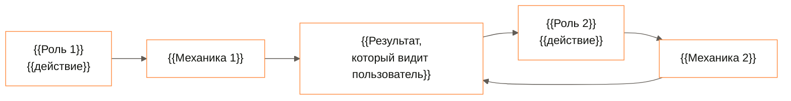
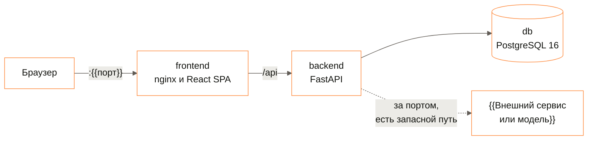
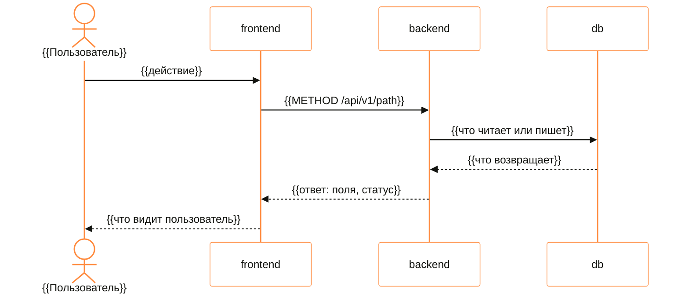

# Архитектура

> Веб-фронтенд удалён 23.10.2026. Разделы с плейсхолдерами ниже — заготовка шаблона и не описывают
> Brim. Реализовано: агент и чат в плагине STE Slicer, backend — необязательный прокси к Claude.

## Что реализовано?

Решение — [ADR 0002](adr/0002-plugin-agent-openai-mcp-host.md); скиллы, документы и справочники — [ADR 0003](adr/0003-agent-skills-documents-knowledge.md).

```
Плагин STE Slicer (Python 3.5, PyQt5)
  окно чата ─► AgentLoop (фоновый поток)
                ├─ LlmClient: POST {URL LLM}/chat/completions ─► LLM организаторов
                │                                              └► backend /v1/chat/completions ─► Claude Agent SDK
                └─ McpHub: tools/list, tools/call
                     ├─ brim (встроенный, всегда включён)
                     └─ внешние серверы (Streamable HTTP)
  LocalMcpServer 127.0.0.1:<порт>/mcp — тот же диспетчер для внешних клиентов
  chats/<id>/ — chat.json, scene.3mf, files/, output/
```

| Часть | Где | Что делает |
|---|---|---|
| Цикл агента | `plugin/Brim/agent/` | Запрос к модели, исполнение инструментов, `ask_user`, подтверждения, лимит шагов, отмена |
| Инструменты слайсера | `plugin/Brim/execution/`, `plugin/Brim/slicer/` | Операции над сценой и настройками, слайсинг, экспорт G-code и 3MF |
| Чат | `plugin/Brim/chat/`, `plugin/Brim/ui/` | Лента из сообщений, карточки вопроса, подтверждения и результата, настройки и MCP-серверы |
| Проекты | `plugin/Brim/workspace/` | Папка на чат, атомарное сохранение сцены, переключение |
| Backend | `backend/` | Stateless `POST /v1/chat/completions` поверх Claude Agent SDK; БД нет |

Решения о печати принимает модель; код не подбирает параметры по правилам. Без настроенной LLM чат
отвечает явной ошибкой. Протоколы — [API](api.md).

> {{PRODUCT}} — {{N}} частей: {{интерфейс, API, хранилище, внешние сервисы}}. {{Главная граница
> системы одной фразой: что решает детерминированный код, а что — модель или внешний сервис, и
> почему основной сценарий работает без сети.}} Здесь — роли, части стенда, путь данных основного
> сценария, слои и то, что заменяется без правки сценариев.

**Читайте, если** вы проверяете техническую проработку или добавляете код · **Связано:**
[API](api.md) · [зависимости](dependencies.md) · [запуск](running.md)

---

## Кто что делает в системе?



| Роль | Что делает | Где проверяются права |
|---|---|---|
| {{Роль 1}} | {{Действия одной строкой}} | {{Раздел API и правило: чужая роль — 403, чужая запись — 404}} |
| {{Роль 2}} | {{Действия}} | {{Раздел API и правило}} |
| Система | {{Что считает и решает сама}} | {{Где живут правила: модуль, сценарий}} |

Права проверяет бэкенд: данные, которые роли видеть нельзя, не уходят во фронтенд вовсе.

## Из каких частей собран стенд?



| Контейнер | Образ | Роль |
|---|---|---|
| `frontend` | `node:22-alpine` → `nginx:{{версия}}-alpine` | Сборка SPA, раздача статики, прокси `/api` на бэкенд |
| `backend` | `python:3.12-slim` | API и сценарии; проверка здоровья — `GET /api/v1/health` |
| `migrate` | образ бэкенда | Миграции схемы одной разовой задачей до старта бэкенда |
| `db` | `postgres:16-alpine` | {{Какие данные хранятся}} |
| `{{сервис}}` | `{{образ}}` | {{Роль; необязательный — под своим profile}} |

{{По одной фразе о том, что важно для проверки: где сессия, как хранится пароль, есть ли состояние в
памяти процесса и что будет при перезапуске.}}

## Как проходит основной сценарий?



{{Абзац: в какой точке этого пути принимается ключевое решение продукта, какой код его принимает и
какой тест падает, если решение нарушено.}}

## Как устроен бэкенд?

```text
backend/
  {{каталог}}/    {{назначение одной строкой}}
  {{каталог}}/    {{назначение одной строкой}}
```

| Слой | Что в нём | Чего ему нельзя |
|---|---|---|
| `{{слой}}` | {{Сущности и правила}} | {{Импортировать фреймворк, базу, HTTP}} |
| `{{слой}}` | {{Сценарии и порты}} | {{Знать о конкретных реализациях}} |
| `{{слой}}` | {{HTTP: роутеры, схемы}} | {{Содержать правила предметной области}} |

Направление зависимостей проверяет `{{тест}}`. Почему слои такие — [ADR {{0001}}](adr/{{0001-slug}}.md).

## Как устроен фронтенд?

```text
frontend/src/
  app/        провайдеры, маршруты, охрана маршрутов, оболочка
  pages/      экран — композиция фич, без своей логики
  features/   пользовательские сценарии
  entities/   данные и их отображение, запросы
  shared/     клиент API, примитивы интерфейса, движение, словари RU и EN, токены
```

Импорты идут только вниз: `app → pages → features → entities → shared`. Типы API генерируются из
OpenAPI бэкенда и руками не пишутся. Тексты интерфейса — только из словарей RU и EN.

## Что заменяется без правки сценариев?

| Порт | Реализация на стенде | Запасной путь | Как переключить |
|---|---|---|---|
| `{{Port}}` | {{Реализация}} | {{Детерминированная реализация без сети и ключей}} | {{Переменная в `.env`}} |
| `{{Port}}` | {{Реализация}} | {{Запасной путь}} | {{Переменная}} |

{{Что будет при сбое внешнего сервиса: таймаут, откат на запасной путь в том же запросе, что видит
пользователь.}}

## Куда класть новый код?

| Что добавляется | Куда | Образец |
|---|---|---|
| {{Новое правило предметной области}} | `{{путь}}` | `{{существующий файл}}` |
| {{Новый метод API}} | `{{путь}}` | `{{существующий файл}}` |
| {{Новый экран}} | `frontend/src/pages/` | `{{существующий экран}}` |

---

<sub>[Оглавление документации](README.md) · [README проекта](../README.md)</sub>
