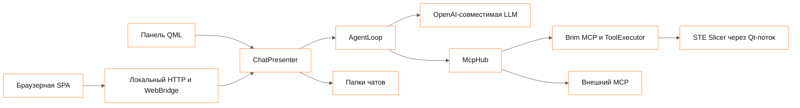

# Архитектура

Агент Brim работает в процессе STE Slicer. Плагин обращается к OpenAI-совместимой LLM и исполняет
её вызовы через встроенный MCP-диспетчер. Docker и backend нужны только при подключении Claude
через предусмотренный в репозитории прокси. Базы данных, очереди и серверного хранилища чатов нет.



## Компоненты

| Область | Код | Ответственность |
|---|---|---|
| Запуск | `plugin/Brim/BrimExtension.py`, `composition.py` | Меню, сборка зависимостей, запуск и остановка локальных серверов |
| Интерфейс | `ui/`, `chat/` | PyQt5/QML, состояние чата, лента, подтверждения, экспорт |
| Браузер | `browser/`, `web/` | HTML/CSS/JS без сборки; HTTP и long polling; та же модель представления, что у панели |
| Агент | `agent/` | Контекст, клиент LLM, цикл инструментов, вопросы и политика подтверждений |
| MCP | `protocol/` | JSON-RPC, схемы инструментов и локальный HTTP-сервер |
| Исполнение | `execution/` | Проверка операций, последовательное применение, числовой анализ геометрии |
| Слайсер | `slicer/` | Профили, материалы, сцена, нарезка, писатели 3MF/G-code, переход в главный поток |
| Рабочие пространства | `workspace/` | История, сохранение сцены, переключение и восстановление проектов |
| Предметные инструменты | `documents/`, `knowledge/`, `engineering/`, `calibration/` | Чтение файлов, справочники, расчёты и калибровочные модели |
| Инструкции модели | `skills/` внутри `plugin/Brim/` | Новичок, инженер, материал, дефекты |

Пути без префикса в таблице относятся к `plugin/Brim/`.

## Один ход агента

1. Пользователь отправляет сообщение. Вложения копируются в папку текущего чата.
2. Плагин собирает историю, выбранный скилл, снимок сцены и текущие включённые настройки.
   Картинки передаются как `image_url`; документы и модели представлены путями к вложениям.
3. `McpHub` получает доступные инструменты. Встроенные имеют обычные имена, внешние —
   `<сервер>__<инструмент>`. Недоступный внешний сервер даёт предупреждение.
4. `LlmClient` отправляет запрос Chat Completions. Ответ приходит целиком, без потока токенов.
5. `ask_user` приостанавливает ход до ответа. Для изменения проекта политика подтверждений
   решает, нужна ли карточка. Отказ с комментарием возвращается модели.
6. Инструмент исполняется; результат и применённые операции сохраняются в истории.
   Перед выполнением записывается отметка неопределённого исхода на случай аварийного завершения.
7. Модель получает результат и продолжает. Успешный `slice` сохраняет G-code и 3MF,
   а интерфейс показывает время и расход материала. Лимит цикла — 40 шагов модели.

## Потоки и отказоустойчивость

Сеть и цикл агента работают вне главного потока Qt. Адаптеры передают работу со сценой,
настройками и слайсингом через `MainThread` и `app.callLater`. `WebBridge` также передаёт действия
браузера контроллеру в Qt-поток. HTTP-потоки не меняют сцену напрямую.

`apply_changes` применяет операции по порядку и не откатывает уже выполненные при ошибке.
Поле `applied` сообщает частичный результат. Остановка агента также не означает откат.
После `interrupted` или `outcome_unknown` нужно перечитать сцену.

Переключение чатов блокирует изменения сцены, сохраняет текущий проект и открывает выбранный.
При неудачной загрузке предпринимается восстановление предыдущего проекта. Неустранимая ошибка
оставляет блокировку и предложение восстановить рабочее пространство.

## Данные на диске

Папка Brim находится в каталоге данных STE Slicer, обычно `%APPDATA%\steslicer\7.x\brim`.
Точный путь берётся из `Resources.getDataStoragePath()`.

```text
brim/
  mcp.json                 адрес и токен локального MCP
  uploads/                 временные загрузки из браузера
  chats/
    index.json             активный чат и состояния сохранённых сцен
    <id>/
      chat.json            история, название, режим, закреплённый скилл
      scene.3mf            последний сохранённый проект
      files/               отправленные вложения
      output/              результаты нарезки
```

Калибровочные файлы и `calibration.json` сохраняются в `files/` текущего чата; точные пути
возвращают инструменты. Резервировать следует весь `brim/` при закрытом слайсере.
Несохранённые черновики живут в памяти. Автоматической синхронизации между компьютерами нет.

## Необязательный backend

`backend/src/app/main.py` собирает `CompletionService`, порт `ChatModel`, адаптер Claude и
необязательное зеркало запросов. Слои `domain` и `usecase` не зависят от FastAPI и SDK;
`adapter` реализует внешние вызовы, `controller` принимает HTTP.

Прокси принимает OpenAI-подобные запросы, преобразует их в transcript для Claude Agent SDK
и возвращает `{text, tool_calls}` в оболочке Chat Completions. Сейчас модель зафиксирована как
`opus`, независимо от поля `model` клиента. Ответы и ключи не сохраняются в базе.

При заполненных `MIRROR_BASE_URL`, `MIRROR_API_KEY`, `MIRROR_MODEL` копия тела запроса уходит
второму провайдеру. Его ответ не участвует в действиях агента. Это не переключение на резервную
модель и не доказательство работы сценария на модели зеркала.

## Границы доверия

Панель и SPA управляют одним локальным слайсером. Браузерный сервер и MCP слушают `127.0.0.1`
и используют разные токены. Внешний MCP-клиент с локальным токеном исполняет команды без карточек
подтверждения. Файлы чатов и ключ LLM в Preferences не зашифрованы плагином.

LLM получает переписку, прочитанные документы, изображения и данные сцены. Подключённые MCP-серверы
получают аргументы вызванных инструментов. Подробные контракты — в [API](api.md),
решения по потокам и хранению — в [технических решениях](design-decisions.md).
