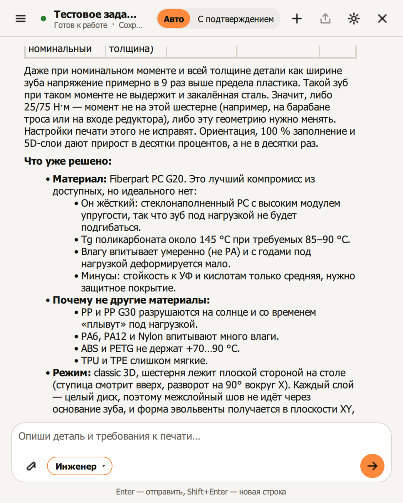
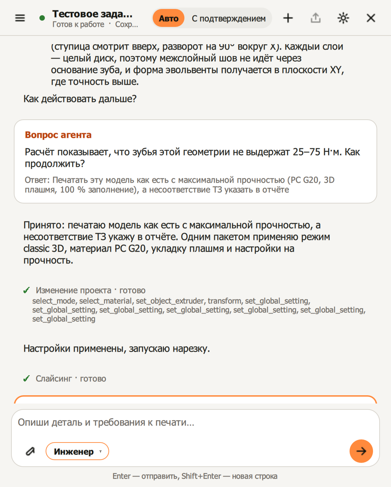

**Слайд 1. Brim**
ИИ-ассистент внутри STE Slicer
STL + фото + ТЗ → чат → готовый проект 3MF, G-code и объяснение решений типа тоже информаграфика

---

**Слайд 2. Что мы сделали: вопросы, фото, настройки**

**Задаёт вопросы**
- Если в ТЗ чего-то не хватает, спрашивает и предлагает варианты кнопками
- Решения с риском не принимает молча: «максимальная прочность или быстрее?»

**Анализ напечатанной детали по фото**
- Находит дефекты: нитки, капли, дыры в стенке, жирный первый слой, расслоение, коробление
- По справочнику из 15 дефектов называет параметры, которые на них влияют
- Предлагает исправления и сам вносит их в настройки

**Помогает в настройках**
- Находит нужный параметр среди 661
- Меняет только нужное, остальное берёт из профиля Stereotech
- Объясняет каждое изменение: зачем и почему такое значение
- Крупные изменения вносит только после подтверждения, есть кнопка «Восстановить проект»

**Делает за пользователя**
- Выбирает режим 3D / 5D Spiral / 5D и ориентирует модель
- Проверяет прочность расчётом
- Нарезает и выдаёт время, расход материала, 3MF и G-code
- Сохраняет переписку отчётом

---

**Слайд 3. Что мы сделали: скиллы и материалы**

**4 режима работы (скилла).** Агент выбирает режим сам, пользователь может закрепить нужный:
- **Новичок:** объясняет параметры простыми словами, ведёт по шагам от модели до G-code, помогает откалибровать принтер
- **Инженер:** читает ТЗ детали (DOCX, PDF, XLSX) и превращает требования в настройки
- **Материал:** подбирает пластик под условия работы детали
- **Дефекты:** разбирает проблемы уже напечатанной детали

**Подбор материала**
- База из 16 семейств пластиков
- Учитывает рабочую температуру, стойкость к маслам, щелочам, кислотам, спирту, УФ и озону
- Учитывает ползучесть, гибкость, плотность, влагопоглощение, трение, проводимость
- Сопоставляет с материалами, которые есть в слайсере
- Честно говорит, какое требование ТЗ выбранный материал не закрывает

---

**Слайд 4. Для кого**

*Инфографика:* три равные карточки в ряд, у каждой иконка, заголовок и одна строка. Снизу общая плашка.

| 🎓 Студенты аддитивных курсов | 🔧 Начинающие технологи | ⚙️ Инженеры |
|---|---|---|
| Учатся печатать, наставника рядом нет | Знают свою деталь, но не слайсер | Умеют настраивать, но тратят время на рутину |

**Плашка снизу:** у всех трёх одна задача — превратить требования к детали в правильные настройки печати без часов ручного подбора.

**Обоснование (говорить словами):**
- Студенту нужен наставник, который объясняет, а не просто ставит галочки. Это скилл «Новичок».
- Технолог печатает функциональные детали по ТЗ: шестерни, оси, колёса. Ему нужен перевод ТЗ в настройки. Это скилл «Инженер».
- Инженеру не нужны объяснения, ему нужна скорость: дал ТЗ — получил проект с обоснованием, переключил материал — не настраивает всё заново.
- Эксперты кейса на консультации подтвердили запрос: «чат-бот, который помогает новичку».

---

**Слайд 5. Боль**
- **661 параметр** в STE Slicer: что трогать — непонятно
- ТЗ говорит «25 Н·м, Tg 85 °C, щёлочь», а слайсер спрашивает «стенки, заполнение»
- 3D или 5D: готовых туториалов по 5D нет
- Ошибка видна только после печати: до 41 % печатей неудачны, до 34 % пластика уходит в отходы
- Новый материал — всё настраивать заново

---

**Слайд 6. Что есть на рынке**

**Creality Print AI.** Рекомендует параметры, проверяет модель, оценивает риски печати. Но работает только с принтерами Creality и только в плоских слоях. Brim встроен в STE Slicer и выбирает между 3D и двумя 5D-режимами.

**JusPrin (Obico).** Пользователь описывает цель одной фразой, ИИ подбирает настройки и нарезает. Это отдельное приложение на движке OrcaSlicer. Brim читает полное инженерное ТЗ, проверяет прочность расчётом и показывает, из какой строки ТЗ взялся каждый параметр.

**Cura MCP / OrcaSlicer MCP.** Внешний ИИ управляет слайсером. Агента пользователь ставит и настраивает сам, это инструмент для опытных. В Brim агент уже внутри плагина: нужны только URL и ключ, а каждое действие видно в чате.

**Итог:** ни одно решение не работает с 5D Stereotech и не читает инженерное ТЗ детали.

---

**Слайд 7. Наше решение: боль → Brim**
| Боль | Brim |
|---|---|
| 661 параметр | Меняет только нужные и объясняет каждый |
| ТЗ ≠ настройки | Таблица требований с цитатами из ТЗ |
| 3D или 5D | Правила по геометрии детали |
| Пробные печати | Расчёт до печати + одна калибровочная фигура |
| Дефект после печати | Фото → дефект → параметры |
| Смена материала | Тот же чат, проект привязан к чату |
| «Что сделал ИИ?» | Каждое действие видно, крупные изменения — с подтверждением |

---

**Слайд 8. Пример: агент усомнился в ТЗ**

Скрины (`img/`):
- `gear-lewis.png` — таблица с расчётом по Льюису
- `gear-verdict.png` — вывод «в 9 раз выше предела» и выбор материала
- `gear-question.png` — вопрос агента и решение пользователя

**Задача:** шестерня, ТЗ: 25 Н·м номинально, до 75 Н·м пиково, Tg ≥ 85 °C, влажность, УФ.

**Что сделал агент:**
1. Оценил по модели геометрию зуба: модуль ≈ 0,8 мм, 39 зубьев.
2. Посчитал изгиб зуба при пиковом моменте 75 Н·м: напряжение ≈ 3100 МПа, запас 0,02.
3. **Усомнился и пересчитал** в самых выгодных условиях: номинальный момент 25 Н·м, вся толщина детали как ширина зуба. Получилось ≈ 520 МПа, в 9 раз выше предела пластика.
4. Сделал вывод: «Такой зуб не выдержит и закалённая сталь». Скорее всего, момент в ТЗ относится к другому валу. Настройками печати это не исправить.
5. **Остановился и спросил**, как продолжить: уточнить момент, печатать с максимальной прочностью или поменять геометрию.
6. Пользователь выбрал максимальную прочность. Агент применил PC G20, режим 3D, укладку плашмя, 100 % заполнения, 4 стенки, нарезал и записал риск в отчёт.

**Итог:** проблема найдена **до** печати, а не после поломки детали. Время 1 ч 30 мин, 4,9 г, от первого сообщения до G-code — 9 минут.
